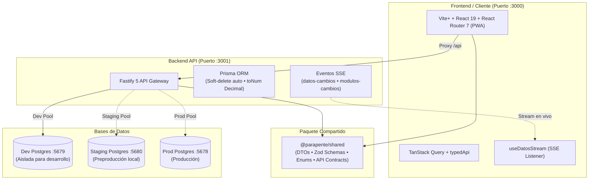
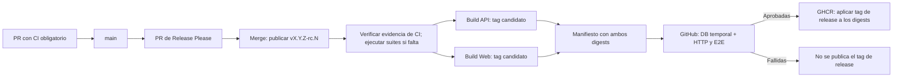

# Parapente School — Sistema de Gestión y Reservas

Sistema web integral y PWA para la gestión operativa, comercial y de seguridad de escuelas de parapente: control de reservas, pasajeros, asignación de pilotos, disponibilidad por bloques horarios, tracking de vuelos, analíticas financieras, equipos y meteorología en tiempo real.

---

## 🏗️ Arquitectura del Sistema



---

## 🚀 Stack Tecnológico

| Capa | Tecnología | Descripción |
|------|-----------|-------------|
| **Frontend** | **Vite+** + **React 19** + **React Router 7** + **Tailwind CSS v4** | SPA con PWA offline mediante `vite-plugin-pwa`, adaptable a móviles y tablets. La compatibilidad con Next.js se conserva para scripts heredados. |
| **Data Fetching** | **TanStack Query v5** + **typedApi** | Cliente Axios con contratos TypeScript compartidos, revalidación selectiva vía SSE y caché optimista. |
| **Backend** | **Fastify 5** + **TypeScript** | Servidor de alto rendimiento con plugins de seguridad (Helmet, Rate-limit, CORS, JWT y Pino Logger). |
| **ORM & BD** | **Prisma 6** + **PostgreSQL 18.4 Alpine** | Enums nativos PG, dinero en `Decimal(12,2)`, soft-delete global automático e índices compuestos optimizados. |
| **Shared Core** | **@parapente/shared** | Contratos de API, validaciones Zod y DTOs compilados con `tsup` compartidos entre web y API. |
| **Testing** | **Vitest** + **Testing Library** + **Playwright** | Suite completa de pruebas unitarias/componentes en frontend y backend, más pruebas E2E en navegador real. |
| **Observabilidad** | **Prometheus** + **Sentry** + contexto `traceparent` | Métricas HTTP y de Node en `/metrics`, captura de errores en API y propagación básica de contexto; exportación OTel a consola es opt-in. |
| **Entrega de releases** | **Docker** + **GitHub Actions** + **GHCR** | API y Web se construyen y prueban en runners hospedados; solo después se publican con el tag RC en GHCR para descargarlas cuando se necesiten. Sin despliegue ni runner de VM. |

---

## 📁 Estructura del Monorepo

```text
paraglide/
├── apps/
│   ├── api/          # Servidor Fastify 5 + Prisma (Puerto :3001)
│   │   ├── prisma/   # Esquema Prisma, migraciones y seeds
│   │   └── src/      # Controladores, servicios, plugins y rutas
│   ├── mcp/          # Herramientas para clientes MCP sobre la API
│   └── web/          # Aplicación Vite+ + React Router 7 + PWA (Puerto :3000)
│       └── src/      # Rutas, componentes, hooks, store y módulos
├── packages/
│   └── shared/       # DTOs, esquemas Zod y tipos comunes (@parapente/shared)
├── docs/
│   ├── adr/          # Decisiones de arquitectura (ADR 001 al 015)
│   ├── diagrams/     # Flujos técnicos con referencias al código
│   └── ci-cd.md      # CI, releases candidatas e imágenes en GHCR
├── deploy/           # Configuraciones de Caddy y proxies de producción
├── docker-compose.yml        # Stack completo de producción
├── docker-compose.dev-db.yml # Base de datos de desarrollo aislada (5679)
├── docker-compose.staging.yml # Entorno efímero de pruebas RC (Web 3200, API 3201, DB 5680)
└── .github/workflows/        # CI y publicación de imágenes RC (rc-images.yml)
```

---

## 🧩 Arquitectura Modular (Básica vs Premium)

El sistema soporta activación de módulos en **runtime y versionada en repositorio**, sin requerir variables de entorno de compilación ni rebuilds.

* **Núcleo Core (Siempre activo):**
  - Inicio / Dashboard (`/`)
  - Pilotos (`/pilotos`)
  - Reservas y Pasajeros (`/reservas`)
  - Calendario de Vuelos (`/calendario` con modal de Configuración de Bloques)
  - Analíticas Financieras (`/analiticas`)
  - Auditoría del Sistema (`/auditoria`, exclusivo ADMIN con paginación keyset)

* **Módulos Premium (Gated):**

| Módulo | Ruta | Descripción |
|--------|------|-------------|
| **Equipos & Mantenimiento** | `/equipos` | Inventario de parapentes, sillas, paracaídas y bitácora de inspecciones. |
| **Manifiestos & Reportes** | `/reportes` | Generación de manifiestos DGAC y exportaciones de vuelos. |
| **Pista & Meteorología** | `/meteorologia` | Monitoreo en vivo de condiciones de despegue y aterrizaje. |
| **Pantalla Sala (FIDS)** | `/pantalla` | Tablero público de salidas y turnos en tiempo real para pantallas de sala. |
| **Plantillas & WhatsApp** | `/plantillas` | Automatización de confirmaciones y deslindes por mensajería. |

* **Mecanismo de Activación:**
  - Fuente de verdad: `apps/api/modules.config.json`.
  - La API expone `GET /api/modules` y el endpoint admin `PUT /api/admin/modules`.
  - Cada mutación emite el evento SSE `modulos-cambios`; la web actualiza la barra lateral al instante sin recarga mediante el runtime `apps/web/src/modules/runtime.ts`.

---

## ⚡ Concurrencia, Tiempo Real y Modo Offline

1. **Server-Sent Events (SSE)**: La web solicita un ticket de un solo uso por `POST /api/eventos/ticket` y conecta a `GET /api/eventos?ticket=...`; el JWT no se envía en la URL. El hook `useDatosStream` invalida selectivamente las queries de TanStack Query correspondientes a la entidad modificada.
2. **Concurrencia Optimista (`version Int`)**: Las rutas versionadas detectan datos obsoletos y responden `409 Conflict`; `PUT /api/pilotos/:id/disponibilidad` compara y guarda en una transacción atómica. La garantía de atomicidad debe comprobarse por endpoint.
3. **Disponibilidad por Bloques Horarios**: Asignación granular de pilotos por bloques de tiempo con soporte para arrastre táctil y selector de jornada completa o parcial.
4. **Arquitectura Offline-First (ADR 009)**:
   - **Navegación sin conexión**: Shell SPA y rutas operativas precalentadas por Workbox, con fallback a `index.html`; las reglas de caché de API y SSE se definen en `apps/web/vite.config.ts`.
   - **Caché en IndexedDB**: TanStack Query + Persister guardan las consultas permitidas por el filtro de persistencia en `parapente-cache` (store `kv`, retención máxima de 7 días; excluye `auth` y vuelos fuera del calendario).
   - **Escritura y Outbox**: Las mutaciones marcadas con `X-Outbox: 1` se encolan en IndexedDB `parapente-outbox` con UUID `X-Client-Id`; la interfaz informa la cola y puede reflejar el cambio de forma optimista.
   - **Replay Automático**: Al recuperar conectividad, el outbox reenvía las operaciones marcadas; el API reutiliza respuestas idempotentes ya registradas para reducir duplicados.

---

## 🗄️ Reglas de Integridad y Rendimiento

* **Manejo de Dinero**: Campos monetarios en `Decimal(12,2)`. Las operaciones aritméticas en backend usan obligatoriamente `toNum()` (`money.util.ts`).
* **Soft Delete Centralizado**: Las eliminaciones lógicas marcan `deletedAt`. La extensión Prisma inyecta automáticamente `deletedAt: null` en las consultas.
* **Contrato de Listados (`listar()`)**: Todas las colecciones responden `{ data, pagination: { page, pageSize, total, totalPages, hasMore, nextPage, nextCursor } }` con un tope estricto de `pageSize <= 500`.
* **Agregaciones en DB**: Sumas y agrupaciones financieras se delegan a PostgreSQL (`groupBy`, `aggregate`, `$queryRaw`), nunca en memoria JS.

---

## 🛠️ Requisitos Previos

- [Node.js](https://nodejs.org/) v22
- [Docker](https://www.docker.com/) & Docker Compose
- npm v9 o superior

---

## 🚀 Inicio Rápido (Desarrollo Local)

### 1. Clonar e Instalar Dependencias
```bash
npm install
```

### 2. Levantar la Base de Datos de Desarrollo (Puerto 5679)
```bash
docker compose -f docker-compose.dev-db.yml up -d
```
> ⚠️ **IMPORTANTE**: La base de datos de desarrollo corre en el puerto **`5679`** (`parapente_dev_db`). **PROHIBIDO** apuntar desarrollo al puerto `5678`, ya que corresponde a la base de datos de producción y las herramientas de dev (`reset-db`, `simulate`) borrarían datos reales.

### 3. Configurar Variables de Entorno
Copia la plantilla `.env.example` en la raíz como `.env`:
```bash
cp .env.example .env
```
Verifica que `DATABASE_URL` apunte al puerto `5679`:
```env
DATABASE_URL="[REDACTED]" # Sustituye por la URL local de desarrollo (:5679).
JWT_SECRET="[REDACTED]" # Define un secreto local fuerte.
PORT=3001
NEXT_PUBLIC_API_URL="/api" # Compatibilidad de módulos heredados; no poner secretos aquí.
INTERNAL_API_URL="http://localhost:3001"
```

### 4. Sincronizar Esquema y Cargar Datos Base
```bash
cd apps/api
npx prisma db push                       # sincroniza schema.prisma (fuente de verdad)
npx tsx scripts/indexes-especiales.ts    # índices BRIN/GIN/parciales (idempotente)
npx tsx prisma/seed.ts
cd ../..
```
> **Esquema**: la fuente de verdad es [`apps/api/prisma/schema.prisma`](apps/api/prisma/schema.prisma).
> [`apps/api/prisma/migrations/`](apps/api/prisma/migrations/) contiene el *baseline* exacto del
> esquema actual por si se necesita reconstruir/adoptar `prisma migrate deploy` ([ADR 015](docs/adr/015-fuente-de-verdad-esquema.md)).
> El deploy de producción usa `db push` **sin** `--accept-data-loss`: un cambio destructivo exige revisión manual.

**Cuenta demo:** la semilla está destinada exclusivamente a la DB local de desarrollo; no usar cuentas demo en entornos expuestos.

### 5. Iniciar Servidores de Desarrollo
```bash
npm run dev
```
- **Web App**: [http://localhost:3000](http://localhost:3000)
- **API REST**: [http://localhost:3001](http://localhost:3001)

---

## 🚢 Integración y releases candidatas

El flujo usa ramas cortas y PR hacia `main`. CI ejecuta tipos, lint y pruebas
según los módulos afectados, con una sola instalación de dependencias. Un cambio
de documentación deja el check disponible sin ejecutar suites.



Solo una RC publicada construye imágenes, con API y Web en paralelo en runners
hospedados por GitHub. Se publican primero con un tag candidato único y se prueban
por digest en un entorno efímero de CI. Si pasan HTTP/E2E, el workflow aplica a
los mismos digests el tag `vX.Y.Z-rc.N` en GHCR. No se usa VM ni runner
self-hosted; las RC no actualizan `latest` ni producción.

Para descargar una versión concreta (con acceso de lectura a los paquetes GHCR):

```bash
docker pull ghcr.io/zer0x25/paraglide-3.0-api:v0.12.0-rc.6
docker pull ghcr.io/zer0x25/paraglide-3.0-web:v0.12.0-rc.6
```

La promoción a Stable se definirá después: deberá usar los mismos digests que
aprobaron HTTP/E2E en GitHub. Ver [CI, publicación de imágenes RC y descargas](docs/ci-cd.md),
incluidos los manifiestos, reintentos y evidencias.

---

## 📊 Endpoints Principales de la API

| Método | Endpoint | Descripción |
|--------|----------|-------------|
| `POST` | `/api/auth/login` | Autenticación y emisión de token JWT |
| `GET` / `POST` | `/api/pilotos` | Listar pilotos (liviano) / Registrar nuevo piloto |
| `GET` / `PUT` | `/api/pilotos/:id/disponibilidad` | Carga on-demand / Guardado atómico con `version` (`409 Conflict`) |
| `GET` / `POST` | `/api/reservas` | Listar reservas con filtros server-side / Crear reserva |
| `GET` / `POST` | `/api/vuelos` | Listado por rango de fechas (`desde`/`hasta`) / Agendamiento |
| `GET` / `POST` | `/api/pasajeros` | Listado y registro de pasajeros |
| `GET` / `POST` | `/api/gastos` | Registro y filtrado de gastos operacionales |
| `GET` / `POST` | `/api/equipos` | Inventario y control de estado de equipos |
| `POST` / `GET` | `/api/eventos/ticket` / `/api/eventos?ticket=` | Solicitar ticket de un uso y abrir el stream SSE (`datos-cambios`, `modulos-cambios`) |
| `GET` / `PUT` | `/api/admin/modules` | Consulta y alternancia en caliente de módulos premium |
| `GET` | `/api/auditoria` | Registro de auditoría con cursor keyset (`nextCursor`) |
| `POST` | `/api/agent/chat` | Interacción con el Copiloto IA SDK |

---

## 🛠️ Scripts Disponibles

| Script | Descripción |
|--------|-------------|
| `npm run dev` | Inicia Web (`:3000`) y API (`:3001`) concurrentemente con base de datos local `:5679` |
| `npm run check:quick` | Build de shared, tipos del monorepo y tests unitarios; lint y formato tienen comandos separados |
| `npm run build:shared` | Compila `@parapente/shared` (`dist/`) con tsup |
| `npm run build` | Compila paquete compartido, API y Frontend para producción |
| `npm run test` | Ejecuta la suite completa de CI (`build:shared` → `test:api` → `test:web` → `test:mcp`) |
| `npm run test:api` | Ejecuta las pruebas unitarias del backend con Vitest y mocks de Prisma |
| `npm run test:web` | Ejecuta las pruebas de componentes y vistas web con Vitest |
| `npm run test:mcp` | Ejecuta las pruebas unitarias del servidor MCP con Vitest |
| `npm run test:e2e` | Ejecuta pruebas End-to-End locales con Playwright |
| `npm run test:ci` | Valida los contratos y la reutilización de evidencia del pipeline |
| `npm run staging:up` | Levanta manualmente un entorno local de pruebas por digest (`web :3200`, `api :3201`, `db :5680`); no lo invoca el pipeline de releases |
| `npm run test:staging` | Ejecuta las siete suites HTTP/navegador (01–07); uso manual o automático en el entorno temporal hospedado de GitHub |
| `npm run test:staging:mvp` | Suite de estrés y combinaciones MVP contra Staging (`:3200`) o Prod (`test:mvp:prod`) |
| `npm run test:staging:reagenda` | Suite de estrés para re-agendamiento dinámico, concurrencia y validación de `version` |
| `npm run test:prod` | Ejecuta la suite E2E completa de 11 pasos contra producción (`https://parapente.zer0x.org`) |
| `npm run deploy:status` | Diagnóstico de despliegue HTTP y estado de contenedores en servidor |
| `npx tsc --noEmit` | Verificación estricta de tipos en `apps/web`, `apps/api` o `apps/mcp` |

---

## 📚 Documentación Adicional

- [Portal de Documentación](docs/README.md) — Índice de producto, arquitectura, diseño y operación.
- [CI, Release Candidates e imágenes GHCR](docs/ci-cd.md) — Flujo vigente, pruebas en GitHub y descarga de imágenes por tag; sin runner local ni despliegue a VM.
- [Architecture Decision Records (ADRs)](docs/adr/README.md) — Historial de decisiones de arquitectura (ADR 001 al 015).
- [Guía para agentes y colaboradores](AGENTS.md) — Invariantes técnicos, seguridad de DB y comandos útiles.

